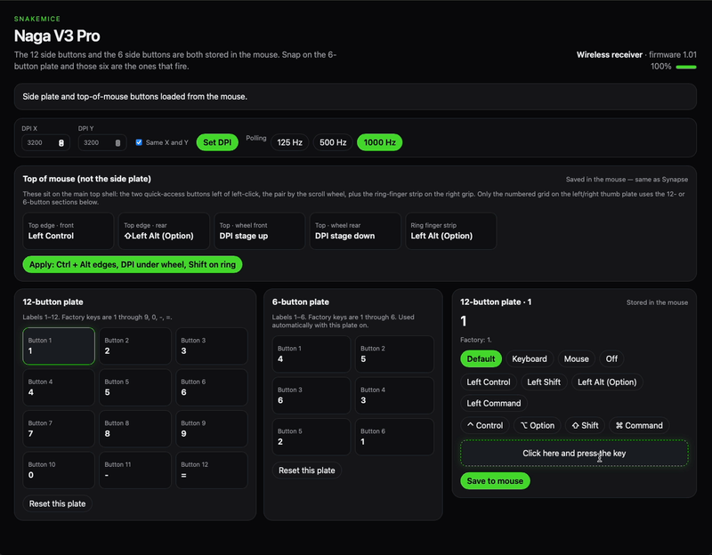

# SnakeMice

A local Mac app for the Razer Naga V3 Pro. Synapse on macOS doesn't talk to this mouse. SnakeMice does, over the USB cable (`1532:00E7`) or the wireless receiver (`1532:00E8`).

## Demo



### Download (no Rust needed)

When a maintainer publishes a build, use **GitHub Releases**:

1. Open **[Releases](https://github.com/jetrotullroa/snakemice/releases)** for this repo.
2. Pick the **latest** release.
3. Download the **Mac** build (usually a `.zip` with `SnakeMice.app`, or the filename in the release notes). Unzip, drag the app to **Applications**, then open it (first time: **Right-click → Open** if macOS blocks it).

Windows users with a Naga V3 Pro can use **Razer Synapse** on PC; this project targets **Mac** users who cannot rely on Synapse for this mouse.

**Before you use SnakeMice:** plug in the **USB cable** or **2.4 GHz dongle**, and **quit Razer Synapse** so it does not fight this app for the mouse.

If there is **no release yet**, install [Rust](https://rustup.rs/) and see **[Run](#run)** below, or ask in Issues for a published build.

Button changes are written into the mouse. They keep working when this app is closed, including in games.

The 12-button plate and the 6-button plate have separate buttons in the mouse:

| Plate | Slots | Factory keys |
|---|---|---|
| 12-button, labels 1–12 | `0x40`–`0x4B` | 1 2 3 4 5 6 7 8 9 0 - = |
| 6-button, labels 1–6 | `0x50`–`0x55` | 1 2 3 4 5 6 |

Snap the 6-button plate on and the mouse uses those six slots by itself. You don't copy the 12-button layout over, and you don't replug.

### Top of mouse (not the side plate)

These are on the **main top shell** (and the right grip strip), not on the magnetic 12/6 thumb plate:

| What you feel | Slot | Factory |
|---|---|---|
| Top edge, front (left of left-click) | 11 | DPI stage up |
| Top edge, rear | 12 | DPI stage down |
| Top, in front of scroll wheel | 106 | Scroll mode |
| Top, behind scroll wheel | 128 | Off |
| Ring-finger strip (right grip) | 57 | HyperShift |

In the app, open **Top of mouse (not the side plate)**. **Apply: Ctrl + Alt edges, DPI under wheel, Shift on ring** sets: top edges → Control and Option, wheel pair → DPI up/down, ring strip → Shift. The underside lock still blocks the ring button when flipped.

The firmware does not report which plate is attached. When a press can only belong to one plate (factory 7, 8, 9, 0, `-`, and `=` are 12-button keys), the matching plate is highlighted.

Bluetooth isn't supported. Use the cable or the receiver. Quit Razer Synapse first so the two programs aren't configuring the mouse at once.

## Run

```bash
cargo run --release
```

The first build takes a few minutes. It compiles a desktop window with Dioxus.

## What you can change

- Each side button: factory key, another key with ⌃ ⌥ ⇧ ⌘, a mouse button, or off
- DPI, from 100 to 50,000, with separate X and Y
- Polling rate: 125, 500, or 1000 Hz
- Battery level

This project is not affiliated with Razer. It does not use Razer Synapse.

### Disclaimer

**Use at your own risk.** SnakeMice is unofficial software: it sends configuration commands to your mouse over USB. Authors and contributors are **not** responsible for any device issues, lost settings, or other harm. If something looks wrong, **quit the app**, **quit Synapse**, and reconnect the mouse on **cable or dongle**. The MIT license also limits liability; see `LICENSE`.

## Open source on GitHub

This repo is meant to be **cloned or downloaded from GitHub** and built with Rust, or to ship **pre-built binaries** from **GitHub Releases** when a maintainer publishes them.

Maintainer: [jetrotullroa](https://github.com/jetrotullroa) — once the repo exists, it will be at `https://github.com/jetrotullroa/snakemice` (adjust the repo name if yours differs).

- **License:** MIT (see `LICENSE` and `Cargo.toml`).
- **Issues & PRs:** Use GitHub for bugs, device quirks, and contributions.

### Build from source (macOS)

**Prerequisites:** [Rust](https://rustup.rs/) (stable toolchain) on a Mac.

```bash
git clone https://github.com/jetrotullroa/snakemice.git
cd snakemice
cargo build --release
```

Run `./target/release/snakemice` (or `cargo run --release`). If `CARGO_TARGET_DIR` is set, look under that directory instead of `./target`.

The first build downloads dependencies and can take several minutes.

### Pre-built downloads (GitHub Releases)

Maintainers can attach a **Mac** build so users **don’t need Rust**:

| Artifact | Notes |
|----------|--------|
| `SnakeMice.app` in a `.zip`, or a raw binary | **Gatekeeper:** unsigned builds may need **Right-click → Open** once, or **System Settings → Privacy & Security → Open Anyway**. Sign and notarize with an **Apple Developer** account for fewer prompts. Ship **arm64** (Apple Silicon), **x86_64** (Intel), or separate builds for each. |

**Suggested release workflow**

1. Tag a version (`v0.1.0`) and push the tag.
2. Build with `cargo build --release` on **macOS** (local or **GitHub Actions** `macos-latest`).
3. Zip `SnakeMice.app` (or the binary), upload under **Releases → Assets**.
4. Link the **latest release** in the README (see [Download](#download-no-rust-needed) above).

Until a release exists, **build from source** is the install path.
